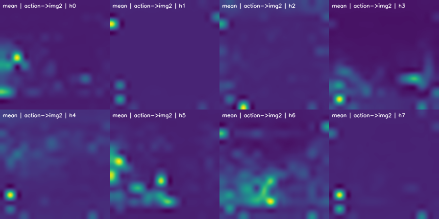
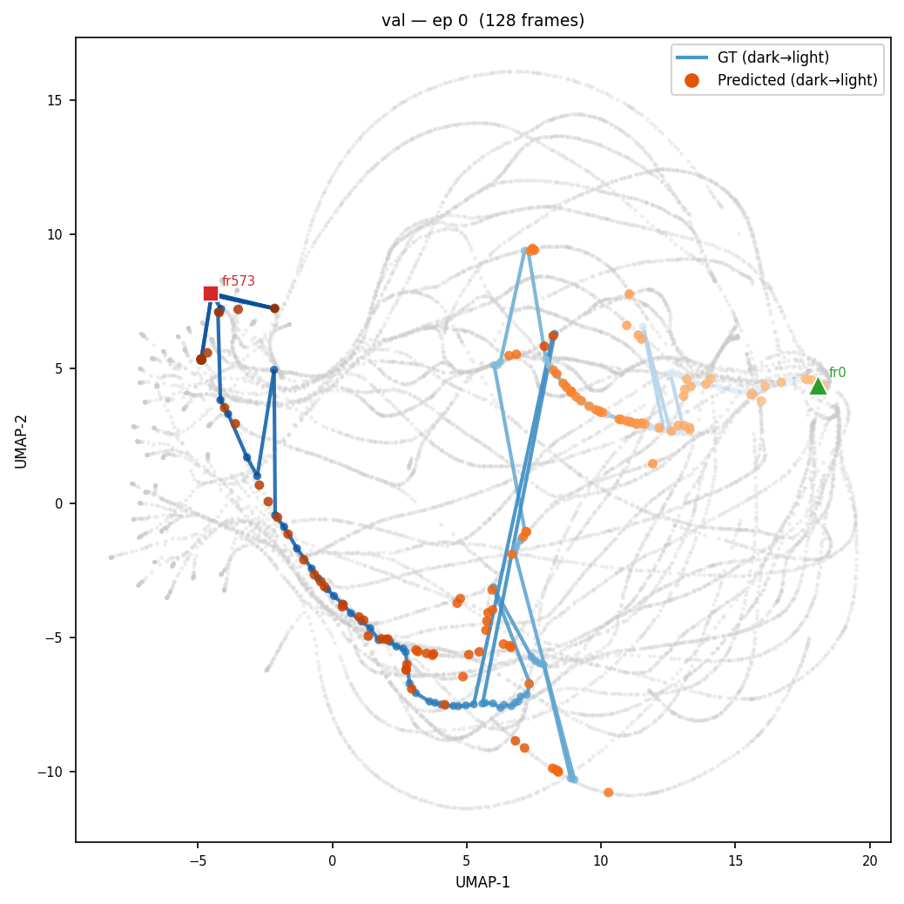

# Validation Metrics & Probes

This repo includes a suite of probes that automatically run during offline training or can be used as standalone scripts. All of them are configured via the `probe_parameters` section in the config file, and run at every validation step (`val_freq`). Results are logged to Aim and saved to `{output_dir}/validation/step_{N}/`.

To launch training with validation probes:

```bash
python -m lerobot.scripts.rl_offline --config path/to/config.yaml
```

Additionally, we provide a tool for visualizing the results across training steps:

```bash
python -m lerobot.scripts.view_probes "path/to/output_dir"
```

It serves a browser UI on `http://127.0.0.1:7870` and re-scans `<run>/validation/step_*/<probe>/` on every request, so a checkpoint that lands mid-session appears on refresh. Each probe describes itself to the viewer through the `index.json` it writes (`probes/manifest.py`), so its documentation, headline numbers, and per-figure captions live next to the code that produces them.

The **Trends** entry at the top of the probe list is one table of the verdict numbers across every step: each probe declares at most one or two metrics with `trend=True` (the flow loss and its val/train gap, the FAST cross-entropy and top-1, the subtask/task/quality separations, the foreign-depth penalty, the history content-gain z). Nothing reaches Aim; the table is read from the same `index.json` files.

The following sections detail what each probe computes and the specific questions it addresses.

## 1. Attention Maps

We compute the following attention maps from layer 0 across all images:
- **Actions**: highlights image regions targeted by action queries.
- **Language**: highlights image regions targeted by language queries.
- **Subtask**: highlights image regions targeted by subtask queries.
- **All**: the average of all attentions, including image-to-image interactions.

Attention maps are computed per head, with the final summary representing the average across all heads. The output of this probe is a video visualizing these maps over the validation set.

If the vision encoder or the first layer of the VLM is frozen, then the attention maps will not change during training.

<p align="center">
  
  <br>
  <em>Visualization of "all" attention heads for trained model.</em>
</p>

If the model is consistently not paying attention to the key objects in the scene, that means the weights have become corrupted and you should retrain the model. Just keep in mind that attention maps come with all sorts of artifacts.

### Standalone

```bash
python -m lerobot.probes.attention --config path/to/config.yaml
```

### Config

| Parameter | Default | Description |
|-----------|---------|-------------|
| `enable_attention` | `true` | Enable this probe |
| `timestep` | `0.5` | Diffusion timestep at which to capture attention |
| `attn_eval_subsample` | `2` | Sample every Nth frame |
| `attn_eval_episodes` | `null` | Specific episodes (null = all sampled) |

---

## 2. Spatial Memorization Probe

The computation here is the same as the attention maps, but now the idea is to compute them from random frames across different episodes and aggregate. Since the frames are all different, you would expect the aggregated maps to be roughly flat. However, if there is spatial memorization — e.g., the model learns the bowl is often in the lower right and just memorizes that — there will be patches of high attention persistent across frames.

This is what the attention looks like for a trained model:

<p align="center">
  
  <br>
  <em>Spatial memorization over actions.</em>
</p>

We do observe a degree of spatial memorization, and it is more pronounced in certain heads. This image in a vacuum is not very informative, but compared across checkpoints we can get a sense of how it evolves. The probe also reports a per-patch signal-to-noise ratio (mean attention divided by its standard deviation across frames): high SNR points to a memorized location, while low SNR points to dynamic, input-dependent attention.

### Standalone

```bash
python -m lerobot.probes.spatial_memorization_attention --config path/to/config.yaml
```

### Config

| Parameter | Default | Description |
|-----------|---------|-------------|
| `enable_spatial_memorization` | `true` | Enable this probe |
| `spatial_layers` | `"0,9,17"` | Layers to analyze |
| `spatial_n_frames` | `32` | Number of frames to aggregate |

---

## 3. Action Drift Jacobian Probe

**What it does**: Uses gradient backpropagation to identify which image regions **causally influence** action generation, beyond just being attended to.

**Why it matters**: Attention shows where the model *looks*, but not whether those regions actually *matter* for the output. A head may attend strongly to a region that has zero effect on the predicted action. The Jacobian probe disentangles attention from causal influence.

### Computation

For a given input, run a forward pass with gradients enabled through the attention mechanism. Let $\mathbf{A} \in \mathbb{R}^{H \times S \times S}$ be the softmax attention weights and $\hat{\mathbf{a}}$ be the predicted action.

1. Compute a scalar loss: $\mathcal{L} = \|\hat{\mathbf{a}}\|_2$
2. Backpropagate: $\nabla_{\mathbf{A}} \mathcal{L}$
3. Compute the **causal map**:

$$\mathbf{C} = \mathbf{A} \odot |\nabla_{\mathbf{A}} \mathcal{L}|$$

**Interpretation**:
- $\mathbf{A}$: which patches are attended to (includes attention sinks that may not matter).
- $|\nabla_{\mathbf{A}} \mathcal{L}|$: how much a change in attention at each position would affect the action.
- $\mathbf{C} = \mathbf{A} \odot |\nabla_{\mathbf{A}} \mathcal{L}|$: patches that are **both** attended to **and** causally connected to the action output.

The probe also exposes a multi-layer variant (`jacobian_probe_forward_multilayer()`) that runs one forward+backward pass per layer, and a spatial-memorization variant that aggregates causal maps across frames the same way the spatial memorization probe does — revealing which memorized positions actively steer actions vs. those that are merely attended.

<p align="center">
  
  <br>
  <em>Action drift jacobian attention map. We can see the model is roughly learning to detect the bounding box of the truck.</em>
</p>

### Standalone

```bash
python -m lerobot.probes.action_drift_jacobian --config path/to/config.yaml
```

### Config

| Parameter | Default | Description |
|-----------|---------|-------------|
| `enable_action_drift_jacobian` | `true` | Enable this probe |
| `enable_spatial_memorization_jacobian` | `false` | Enable spatial+Jacobian variant |
| `spatial_layers` | `"0,9,17"` | Layers for multi-layer analysis |

---

## 4. Action Manifold Probe

This probe checks whether predicted action chunks lie on the same manifold as the ground-truth actions. The motivation is that loss alone doesn't tell you if the model is generating plausible actions — a model can have low average loss but still produce action chunks that drift outside the distribution of physically meaningful motions.

The probe runs in two phases. **First**, at startup, it builds a reference manifold: ground-truth action chunks from the validation set are flattened, reduced with PCA (down to `action_pca_dims` components), and then UMAP'd to 2D and 3D. The PCA and UMAP transforms are **frozen** after this step so that any change in the embedding reflects changes in the model, not the projection.

**Second**, at every validation step, predicted and ground-truth actions are projected through the frozen transforms. For each predicted point, the probe finds its nearest neighbor in the reference set and reports the distance. The headline scalar logged to Aim is the ratio of the median predicted nearest-neighbor distance to the median ground-truth nearest-neighbor distance — a value near 1.0 means predictions sit on the manifold; much larger than 1.0 means they're drifting off it.

The probe also outputs a PCA scree plot, which is a useful sanity check on the intrinsic dimensionality of the action space.

<p align="center">
  
  <br>
  <em>Action manifold of root dataset (grey paths) and validation episode with ground truth and prediction projection. Red square is starting point and green triangle is end point Interestingly, the validation ground truth nor the prediction follow a smooth path in the root dataset manifold. Might be worth exploring further.</em>
</p>

### Outputs

| File | Description |
|------|-------------|
| `2d/trajectories.png` | GT paths + predicted points on reference manifold |
| `2d/by_frame.png` | Colored by frame index |
| `2d/by_subtask.png` | Colored by subtask label |
| `3d/by_episode.html` | Interactive 3D Plotly scatter |
| `nn_distances.csv` | Raw NN distance statistics |

### Standalone

```bash
python -m lerobot.probes.actions --config path/to/config.yaml
```

### Config

| Parameter | Default | Description |
|-----------|---------|-------------|
| `enable_actions` | `true` | Enable this probe |
| `action_pca_dims` | `50` | Number of PCA components |
| `ref_max_episodes` | `20` | Episodes used to build the reference manifold |
| `ref_n_frames_per_episode` | `256` | Frames per episode for reference |
| `umap_n_neighbors` | `15` | UMAP neighborhood size |
| `umap_min_dist` | `0.1` | UMAP minimum distance |

---

## 5. Representation Trajectories

The representation probe follows sampled frames through episodes and finds, for every frame, the frames in other episodes (other tasks, other robots) whose representation is closest, then shows how that match evolves in time around both frames. It captures separate token groups at selected layers, using the same fixed-noise, first-flow-step adapter path as the conditions matrix. The default is **native attention input**, normalized by the model before pooling. This path currently requires the MolmoAct2 per-layer capture adapter.

Open `trajectories.html` in the probe viewer, or directly in a browser from its own directory: the page is light and loads one group/layer/prompt/geometry panel at a time from `panels/<key>.js` (and the packed every-frame matrix from `panels/<key>.cross.js` when the aligned grid is used), and reads camera previews from `cache/thumbs/`, so keep the directory together when copying a report. Select a group, layer, prompt, geometry and measure, then pick an episode and slide through its frames (←/→ step, space plays). Each frame drives both camera previews, a crosshair on the episode's matrix, the frame's profile along the episode, the ranked matches in other episodes and the aligned cross-episode grid. Every plot carries a caption saying what its axes and reference lines are.

- **Why raw cosines are ~1:** all model states share a large common direction, so the cosine between any two raw vectors is close to 1 and every similarity looks high. The geometry selector sets what is removed first: *raw* (nothing), *subtract robot mean* (that robot's sampled training-frame mean, so cosines compare deviations from the robot's typical state) or *subtract episode mean* (each episode's own sampled mean, so only motion within the episode remains). The report defaults to robot-centered.
- **Measure:** cosine compares directions only; L2 distance combines direction and magnitude; log2 norm ratio (column over row) is magnitude only. The last two are derived in the browser from the stored cosines and the per-frame norms of the chosen geometry, so one stored matrix serves all three; the background levels for each are precomputed. Matches are always found by cosine and then shown under the chosen measure.
- **Background:** every frame carries its mean cosine (and distance, and log norm ratio) to all frames of other episodes, same robot and other robots. It is the level a similarity must clear before it says anything about the episode rather than the robot. The *Selected frame against its episode* panel draws the selected frame's cosine to every frame of its episode next to that line and its best matches.
- **Within-episode matrix:** every sampled frame of the episode against every other, in the original dimensions of the chosen geometry and measure. The color range fits the episode by default, so block structure is visible even when all values sit between 0.98 and 1; "same for all episodes" uses the panel-wide range to compare episodes. Clicking a cell selects its row frame.
- **Nearest frames in other episodes:** exact nearest cosine, excluding the whole source episode, split into same/different robot × same/different task. Each category lists the best frame of each of the top `MATCH_TOP_K` (5) other episodes, best first, so alternatives can be browsed; `matches.csv` carries the rank. Task equality uses the exact recorded string, not a semantic classifier. Each match includes raw norm ratio/difference, distance in the selected geometry, candidate counts, and anchor-to-target-neighborhood mean cosine (local support, not temporal alignment). *Align grid* on a row centers the grid on that match.
- **Aligned cross-episode grid:** the selected frame and the frame it is aligned with (the best match of any category, a category's match of a chosen rank, or the best frame of a chosen episode) sit at the center cell. Rows are the selected episode at offsets −Δ·span … +Δ·span seconds from the selected frame, columns the other episode at the same offsets from the aligned frame; Δ (1/2/4/8 s) and span (±5 → 11×11, ±7 → 15×15) are selectors. Each cell is the measure between the sampled frames nearest to those two times (hover shows the frames used; cells past an episode's ends are blank; a Δ below the sampling stride reuses frames, and the status line says so). A bright diagonal through the center means the two episodes pass through the same sequence of states at the same pace; a diagonal with another slope is the same sequence at another speed; a bright row or column means one episode holds still in a state the other passes through; a single bright center cell is a momentary coincidence. The side plot pulls the diagonal, the center row and the center column out of the grid against the selected frame's background. The grid reads the packed every-frame matrix (`repr_cross_matrices`, uint16, N² × 2 bytes per panel: 5 MB at 1600 frames), loaded only when used.
- **Along the episode:** for every frame of the selected episode, its background (same robot, and other robots when present) and its best match per category. The background is a mean and the match lines are maxima over all candidates, so the match lines always sit above the background: what carries information is the gap between them and how it changes along the episode, not their height. A stretch where a match line rises well clear of the background is where the episode has a specific counterpart elsewhere, and the place to read the aligned grid.
- **Local temporal cosine:** average cosine to other sampled frames in the same episode within a radius, excluding the frame itself. `repr_local_window_s` fixes the radius written to `temporal.csv`; the report's radius slider recomputes the value shown under the profile from the matrix.
- **Text control:** real task/subtask prompts and constant prompts (`Manipulate the object.` / `continue the task`) use the same observations and noise. Labels displayed in the report remain the real labels. Constant text is not proof of visual grounding.

Raw norms are always saved before centering and unit normalization. A match is only a candidate: check the aligned grid and the frames. These dataset replays cannot establish why a closed-loop policy diverted.

**Sampling.** Candidates come from configured LeRobot sources, additional datasets, validation roots and the enabled diverse corpus (training and held-out anchors). Every episode is sampled at one frame every `repr_stride_s` seconds (the stored image frame, or corpus anchor, nearest to each multiple of the stride from the episode's first frame; nothing is interpolated, so data sparser than the stride yields fewer frames). Episodes with fewer than `repr_min_frames_per_episode` frames at the stride are left out. The rest are balanced over robot/task/split, up to `max_episodes` **per robot**, and taken whole in that order while they fit under `repr_max_frames`; an episode that no longer fits is skipped, never thinned, so the aligned grid always has a frame near every offset it asks for. At the 2 s default, 1600 frames is about 18 three-minute episodes. The report shows the stride and the median sampling gap. At least two episodes with identical task text are needed for same-task matches. The cost that grows with the frame count is the packed every-frame matrix (N²): above a few thousand frames, raise `repr_max_frames` with care.

### Standalone

Run from the workspace root with the root environment:

```bash
.venv/bin/python -m lerobot.probes.representations --config config_rl.yaml
# Recompute measurements and the report from this checkpoint's saved cache (no model, no datasets):
.venv/bin/python -m lerobot.probes.representations --config config_rl.yaml \
    --probe_parameters.mode=plot
```

Uses `policy.pretrained_path`; writes `<probe_parameters.output_dir>/validation/step_<checkpoint>/representations/`. The validation suite calls the same `run()` when `enable_representations=true`. Plot mode loads neither model nor datasets and accepts an existing cache from the current protocol. Old whole-sequence activation caches must be recollected, and so must caches sampled before the stride existed if the grid is to have frames at every offset.

### Config

| Parameter | Default | Description |
|-----------|---------|-------------|
| `enable_representations` | `false` | Validation-suite switch; enabled in the workspace YAML configs |
| `repr_view` | `attention_input` | Native view, or `block_output`; changing view requires recollection |
| `repr_layers` | `14,28,32` | Zero-based block indices; changing to uncached layers requires recollection |
| `repr_groups` | `action,img_external_0,img_wrist_0,state` | Separate pooled token groups; `subtask,action_output` also supported |
| `repr_constant_text` | `true` | Capture real and constant task/subtask text; doubles forwards |
| `repr_stride_s` | `2.0` | Seconds between sampled frames within every episode |
| `repr_max_frames` | `1600` | Total physical frames across robots and splits, before text duplication; whole episodes are kept while they fit |
| `repr_min_frames_per_episode` | `5` | Episodes with fewer frames at the stride are left out |
| `repr_local_window_s` | `2.0` | Radius in seconds for `temporal.csv` and the report's initial slider value |
| `repr_cross_matrices` | `true` | Write the packed every-frame cosine matrix per panel for the aligned cross-episode grid |

`repr_n_frames_per_episode` and `repr_pca_dims` are legacy and ignored; UMAP options and the generic `timestep` do not control this probe. Outputs include float32 caches with presence masks, `sampling_plan.json` (with the stride), `temporal.csv` (with background cosines), `matches.csv` (ranked), `summary.json`, the per-panel `panels/*.js` and `panels/*.cross.js` the report loads, and the viewer manifest. Missing token groups are reported and excluded.

---

## 6. Action Inspector

The most direct measure of action prediction quality, and the probe that answers "is this checkpoint any good". At anchor frames spaced through the validation episodes it draws `trace_n_samples` flow samples of the action chunk and reports two independent readouts.

**Baseline-relative fit.** MSE between flow sample 0 and the demonstrated chunk, in the normalized model space the policy trains in. Flow-matching loss measures the velocity-field error during training; this measures the output error the robot experiences. The absolute number means nothing on its own, so it sits next to the two constant predictors it has to beat — repeating the measured pose for the whole chunk (`baseline_hold`), and the mean demonstrated chunk over the anchors (`baseline_dataset_mean`). `skill_vs_hold` and `skill_vs_mean` are the fraction of each baseline's error the policy removes; at or below zero the policy is not predicting. The per-joint split in `action_metrics.json` is where systematic bias shows up (a gripper that is always slightly closed, a joint that consistently lags).

**Task-space geometry.** The chunk is put through the reBot URDF, giving a table-clearance pre-flight check from per-link convex hulls, the multimodality fan across samples, and Cartesian error against GT. All of it is open-loop: every anchor restarts from a demonstrated state, so compounding error and recovery are invisible by construction, and Cartesian divergence from GT is not automatically error on a multimodal task.

Output is one interactive Plotly page (`action_trace.html`) plus `metrics.csv`, `action_metrics.json`, and — on an `action_mode=both` checkpoint — a scale-locked FAST-vs-flow scene in `decoder_comparison.html`.

### Standalone

```bash
python -m lerobot.probes.action_trace_probe --config path/to/config.yaml
```

### Config

| Parameter | Default | Description |
|-----------|---------|-------------|
| `enable_action_trace` | `false` | Enable this probe |
| `trace_anchor_stride_s` | `2.0` | Seconds between anchor frames |
| `trace_max_anchors_per_episode` | `30` | Per-episode anchor cap |
| `trace_n_samples` | `5` | Independent flow draws per anchor (the fan) |
| `trace_clearance_warn_m` | `0.01` | Samples dipping below this are drawn red |

---

## 7. Spatial Memorization (Causal Jacobian Variant)

A variant of the spatial memorization probe (Section 2) that aggregates **causal** attention maps $\mathbf{A} \odot |\nabla_{\mathbf{A}} \mathcal{L}|$ instead of raw softmax attention $\mathbf{A}$. It reuses the same frame-sampling and rendering pipeline as Section 2, but asks the policy adapter for `capture_attention(..., requires_grad=True)` so that a backward pass through the attention weights is included.

Use this when the raw-attention spatial memorization map (Section 2) shows a persistent hot spot and you want to know whether that hot spot actually drives the action output, or whether it is an attention-only artifact uncorrelated with the policy's decisions.

Output directory: `{output_dir}/spatial_memorization_action_jacobian/`.

### Standalone

```bash
python -m lerobot.probes.spatial_memorization_action_jacobian --config path/to/config.yaml
```

### Config

| Parameter | Default | Description |
|-----------|---------|-------------|
| `enable_spatial_memorization_jacobian` | `false` | Enable this probe (off by default — requires a backward pass per sampled frame) |
| `spatial_layers` | `"0,9,17"` | Layers to analyze |
| `spatial_n_frames` | `32` | Number of frames to aggregate |

---

## 8. Critic Values Distribution

When the distributional critic is enabled (`skip_critic: false`), this probe samples validation frames and characterizes the critic's output. It is policy-agnostic — it works against any policy whose `ProbablePolicy` adapter implements `predict_value` and `predict_value_and_probs`. Adapters that additionally implement `value_gradient_magnitude` get the gradient-based plots and percentile-exemplar frames; otherwise those sections are skipped.

Outputs (under `{output_dir}/critic/`):

| File | Description |
|------|-------------|
| `predicted_distributions.png` | Per-frame $P(V)$ curves with $\mathbb{E}[V]$ overlay |
| `advantage_dist.png` | Advantage ($r + \gamma V(s') - V(s)$) histogram with the p5/p10/p50/p90/p95 cuts, CDF, $V(s)$ histogram, by-subtask boxplot |
| `advantage_weights.png` | The AWR weights the actor trains with (`lerobot.rl.advantage`, the trainer's own formula): standardized advantage, weight histogram, beta sweep |
| `advantage_weight_where.png` | Mean weight by seconds to the segment end, by mistake flag, by quality label |
| `advantage_percentiles.png` | Camera frames nearest each percentile cut, two per cut from different segments, with $A$, $\hat A$, $w$, $V$, $V^*$ |
| `value_vs_time_to_end.png` | $V(s)$ against seconds to the segment end with the duration-only ideal $V^*$ |
| `value_by_label.png` | Mean $V - V^*$ by quality label and mistake flag |
| `value_outliers.png` | The two most pessimistic and two most optimistic frames against $V^*$ |
| `gradient_magnitudes.png` | $\|\nabla_\text{vision} V\|$ distribution (only when the adapter supports it) |
| `frame_p{XX}.png` | Percentile-exemplar frames at $V$ deciles (only when the adapter supports it) |

The probe is a no-op when `skip_critic: true` (the policy has no critic head to query).

### Standalone

```bash
python -m lerobot.probes.critic --config path/to/config.yaml
```

### Config

| Parameter | Default | Description |
|-----------|---------|-------------|
| `enable_critic_values_distribution` | `false` | Enable this probe (off by default — requires backward when the gradient sections are active) |
| `critic_adv_frames` | `1000` | Frames sampled for the advantage, weight and $V(s)$ distributions and the percentile frames (two critic forwards each; `config_rl_validate.yaml` uses 512) |
| `critic_grad_frames` | `200` | Frames sampled for $\|\nabla_\text{vision} V\|$ (forward + backward) |

---

## 9. MEM History Influence

**What it does**: Measures whether the content of short-term image and state history helps the predicted action chunk. Depth history remains fixed and is covered by the depth-modality probe.

**Why it matters**: Removing history entirely is an out-of-distribution prompt because training uses `history_dropout: 0.0`. A large difference from a dropped-history prompt can therefore be a shape failure rather than evidence that the model uses temporal information. This probe keeps both history channels present and changes only their contents.

### Computation

For a probe frame at global index $g$ (episode start $g_0$), the deployed lookback is $-6/-4/-2$ s: offsets $[180,120,60]$ at 30 fps, oldest to newest, repeat-padded to $g_0$ on underflow:

$$V = (I_{g-180},I_{g-120},I_{g-60})\ \text{per camera}, \qquad S = (s_{g-180},s_{g-120},s_{g-60}).$$

Image history and state history independently receive one of three treatments:

- `real`: the true lookback window;
- `constant`: the current frame or state copied into all three slots, preserving the trained prompt shape while removing information unavailable in the present;
- `foreign`: a complete window from a different held-out episode, preserving realistic statistics but supplying the wrong scene.

Crossing the treatments produces a $3\times3$ factorial. Every cell uses the same frame and seeded flow noise. The legacy `none` condition, which drops image and state history, is still reported only for comparison with older captures and is never the origin of a claim.

For each cell $c$, compare its normalized action chunk with the demonstration $a^\star$ and with the `real/real` prediction:

$$\Delta\operatorname{MSE}(c)=\operatorname{MSE}(a^{(c)},a^\star)-\operatorname{MSE}(a^{(\mathrm{real/real})},a^\star).$$

Positive means the true window predicts the demonstration better. The primary contrast is `constant/constant`, which measures what information beyond the present is worth. `foreign/foreign` checks whether the policy needs this trajectory's history rather than merely any populated window. Per-frame paired differences produce a separate standard error and 95% interval for every contrast. RMSE and maximum absolute action change against `real/real` are reported alongside usefulness so a near-zero intervention is not mistaken for a successful one.

### Outputs

| File | Description |
|------|-------------|
| `influence.json` | Per-frame factorial values, paired penalties, RMSE/max-absolute changes, and exact history provenance |
| `influence.png` | $3\times3$ treatment grid, paired usefulness contrasts with 95% intervals, and action influence |
| `index.json` | Manifest consumed by `view_probes` |

Registered probe only (runs at each validation step; no standalone CLI). Skips itself when no short-term memory is configured or `action_mode: discrete`.

### Config

| Parameter | Default | Description |
|-----------|---------|-------------|
| `enable_mem_history_influence` | `false` | Enable this probe |
| `n_frames_per_episode` | `128` | Frames measured per episode (10 forwards each: nine factorial cells plus `none`) |
| `max_episodes` | `5` | Episodes sampled |
| `random_seed` | `42` | Frame-sampling seed |

---

## 10. MEM Temporal Attention Mass

**What it does**: For each temporal layer of the MEM video encoder, measures when and where the current frame reads its three history frames.

**Why it matters**: History can be present without being selected, and attention can sit on a position without delivering meaningful values. This probe separates amount read, selected age, head agreement, positional artifacts, and delivered magnitude.

### Computation

Every `temporal_layer_stride`-th ViT block first performs time-only attention. For one current-frame patch, the keys are the same spatial position at $-6,-4,-2,0$ s. Spatial attention is a separate operation with its own softmax. If $T=3$ denotes the history ages, the current query's past mass is

$$m^{(\ell)}_{h,i}=\sum_{\tau=1}^{T}w^{(\ell)}_{h,i,\tau}.$$

The time-only softmax has $T+1=4$ keys, including the current timestep. An indifferent allocation therefore gives

$$m_{\mathrm{uniform}}=\frac{T}{T+1}=\frac34.$$

The headline enrichment is measured past mass divided by $3/4$: 1 means indifference, above 1 prefers history, and below 1 prefers the current frame. The probe also records:

- per-frame and per-layer distributions rather than only a global mean;
- the age profile across $-6/-4/-2$ s, its log-slope in inverse seconds, normalized entropy, and agreement between heads;
- $w_k\lVert v_k\rVert$, which checks whether attended history carries delivered magnitude;
- labelled-mistake overlap at each exact history age;
- optional `constant` and `shuffled` controls that leave age embeddings fixed and test whether the age profile follows content or slot position.

### Outputs

| File | Description |
|------|-------------|
| `temporal_attention.json` | Human-readable summary, provenance, layer distributions, and per-frame values |
| `temporal_attention_data.npz` | Per-frame/layer/camera/head/age/patch arrays and optional control arrays |
| `temporal_attention.png` | Past-mass distribution, age profile, specialization, agreement, controls, and delivery panels |
| `examples/frame_p*.png` | Low/median/high read examples with the selected history frame and spatial overlay |
| `mistakes/*.png` | Per-age sequences around labelled mistakes and recovery frames |

Registered probe only (runs at each validation step; no standalone CLI). Implemented via a zero-overhead capture hook in `_temporal_vision_block` (`_MEM_TEMPORAL_CAPTURE`, no-op when disabled). Skips itself when no image history is configured.

### Config

| Parameter | Default | Description |
|-----------|---------|-------------|
| `enable_mem_temporal_attention` | `false` | Enable this probe |
| `n_frames_per_episode` | `128` | Frames measured per episode (one prefix forward each) |
| `max_episodes` | `5` | Episodes sampled |
| `random_seed` | `42` | Frame-sampling seed |
| `mem_temporal_positional_control` | `false` | Add constant and shuffled controls (two extra prefix forwards per frame) |

---

## 11. MEM History Regime

**What it does**: Splits the average history effect into frames helped, hurt, or indistinguishable from flow-sampling noise, and tests the correct history against a stale but well-formed window.

### Computation

Five forwards share the same present observation:

| Condition | History | Flow seed |
|-----------|---------|-----------|
| `emptied` | Present frame/state copied into all three slots | 0 |
| `full` | Real $-6/-4/-2$ s window | 0 |
| `stale` | The configured window gathered six seconds earlier, giving effective ages $-12/-10/-8$ s | 0 |
| `emptied'` | Same as `emptied` | 1 |
| `none` | Image/state history dropped; legacy out-of-distribution reference | 0 |

The content effect on each frame is

$$\Delta(\mathrm{full})=\operatorname{MSE}(\mathrm{emptied})-\operatorname{MSE}(\mathrm{full}).$$

The sampler floor is $\tau=Q_{0.9}(|\Delta(\mathrm{emptied}')|)$. A frame is helped when $\Delta(\mathrm{full})>\tau$, hurt when it is below $-\tau$, and otherwise indistinguishable. The paired stale comparison reports $\operatorname{MSE}(\mathrm{stale})-\operatorname{MSE}(\mathrm{full})$ and a z-score; positive values support the claim that the model uses this window's content rather than merely reacting to a populated history. Path, temporal-shape, final-position, and final-direction errors are reported separately.

### Outputs

| File | Description |
|------|-------------|
| `regime.json` | Summary, per-frame verdicts, sampler floor, stale-content evidence, and trajectory metrics |
| `regime.png` | Effect distributions, movement-versus-benefit scatter, and verdict fractions |
| `examples/*.png` | Representative helped, hurt, and moved-but-null frames with all three history ages |
| `index.json` | Manifest consumed by `view_probes` |

### Config

| Parameter | Default | Description |
|-----------|---------|-------------|
| `enable_mem_history_regime` | `false` | Enable this probe |
| `n_frames_per_episode` | `128` | Frames measured per episode (five forwards each) |
| `max_episodes` | `5` | Episodes sampled |
| `random_seed` | `42` | Frame-sampling and flow-noise seed |

---
